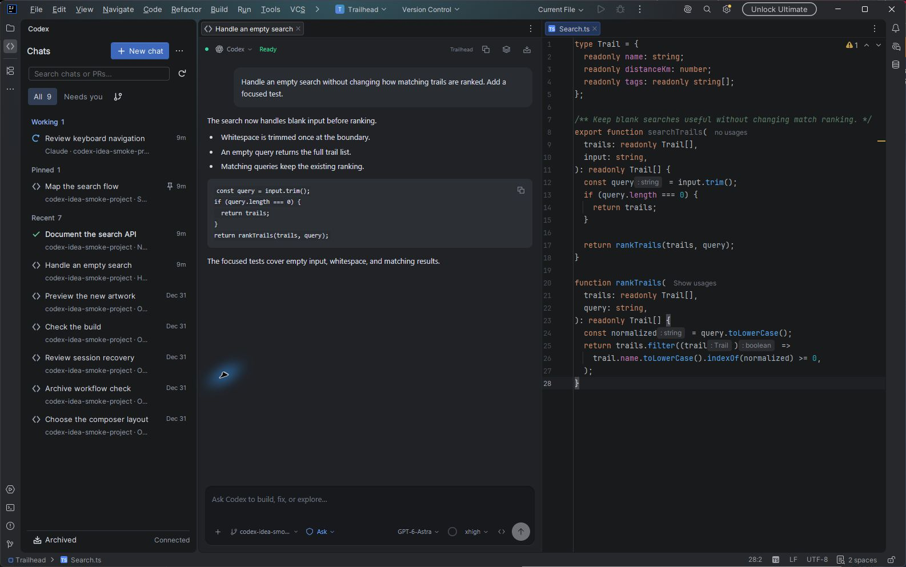
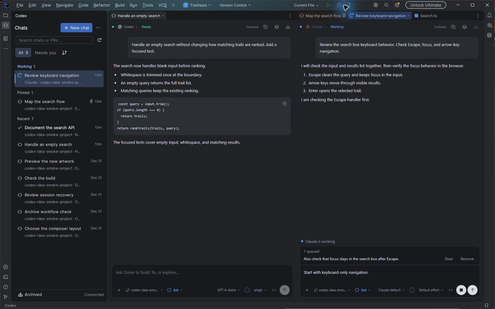

# Marketplace listing

The listing is at <https://plugins.jetbrains.com/plugin/34172-codex-tabs>.

Keep the overview in `src/main/resources/META-INF/plugin.xml` so the next release carries the current copy. If you update the live description before a release is approved, choose **Until next update** when Marketplace asks whether to preserve the web edit.

The listing has a Getting Started section for installation, executable paths, custom API connections, WSL, and Claude keyboard shortcuts. Its documentation link points to the README installation guide. Its bug tracker points to GitHub Issues.

## Screenshot capture

Use the test-only `MarketplaceDemo` fixture described in `scripts/native-smoke/README.md`. It opens real IDEA editor panes and the production plugin UI with fictional conversations. No model is called. The fixture belongs only in a disposable IDE profile.

Use the same IDE window size for each capture. The fixture provides these views:

- **overview:** A chat beside the search source file, with the chat sidebar visible.
- **diagram:** A Mermaid flowchart rendered inside a native chat tab.
- **claude:** A running Claude demo with a queued follow-up, Steer and Remove controls, and a draft.

Use the default dark IDE theme. Keep text readable and exclude other windows, desktop backgrounds, private chats, account details, and machine paths. Check each image before uploading. Demo conversations illustrate the interface and are not performance measurements.

## Published gallery

The Marketplace gallery uses two unedited 1586 x 993 captures from IntelliJ IDEA with the default dark theme and fictional demo conversations.

### Native tabs beside code

### Codex and Claude side by side

## Release validation

Version 1.0.21 passed the core suite, all 28 web unit tests, the provider browser checks at 360 and 900 pixels, and plugin structure validation. The native chat-file regression check verified no source document, stable restored URLs, and repeated opening and closing through the custom editor. Kubernetes was not enabled in the isolated profile, so its optional live check was skipped.

JetBrains accepted 1.0.21 for review on 2026-10-21 as update `1199288`. Upload acceptance is not public release approval.
